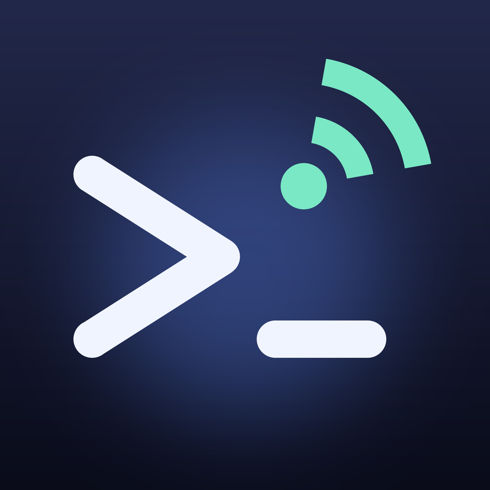

<p align="center"></p>

<h1 align="center">Remote Code</h1>

<p align="center">Mac'inizdeki <b>Claude Code</b>, <b>Codex</b> ve <b>Gemini CLI</b>'ı iPhone veya iPad'inizden yönetin.<br><sub>Eski adıyla Pilothouse.</sub></p>

<p align="center">
  <a href="https://github.com/ardasnturk/remote-code/releases/latest"></a>
  <a href="https://github.com/ardasnturk/remote-code/actions/workflows/ci.yml"></a>
  
  <a href="LICENSE"></a>
</p>

<p align="center"><a href="https://rcode.ardasnturk.com">Web sitesi</a> · <a href="README.md">English</a> · <b>Türkçe</b></p>

> **Remote Code; Claude Code, Codex ve Gemini CLI ile çalışır.** Bağımsız, açık
> kaynaklı bir projedir; **Anthropic, OpenAI veya Google ile bağlantılı
> değildir, onlar tarafından onaylanmamış veya desteklenmemiştir.** Bu araçları
> kendi koşullarına uygun kullanmak sizin sorumluluğunuzdadır.

Remote Code iki uygulama ve ortak bir Swift paketinden oluşur:

* **Mac için Remote Code** — Mac'inizde resmi ajan komut satırı araçlarını
  (`claude`, `codex`, `gemini`) başlatan ve denetleyen, Mac'i uyanık tutan ve her şeyi eşleştirilmiş
  cihazlarınıza ileten küçük bir menü çubuğu uygulaması.
* **iPhone ve iPad için Remote Code** — herhangi bir proje klasöründe oturum
  başlatın; yanıtları, düşünmeyi, araç çağrılarını, farkları (diff) ve terminal
  çıktısını canlı izleyin, her işlemi onaylayın ya da reddedin.

Remote Code **Anthropic, OpenAI veya Google'a hiçbir zaman bağlanmaz** ve kimlik
bilgilerinize asla dokunmaz: tüm yapay zeka işini kendi hesaplarınızla giriş
yaptığınız CLI'lar yapar. Sunucu, hesap ya da telemetri yoktur — yalnızca uçtan
uca şifrelenmiş şekilde konuşan kendi cihazlarınız vardır.

## Özellikler

* **Elinizdeki tüm ajanlar** — yeni sohbette Claude Code, Codex ya da Gemini
  CLI'ı seçin; Remote Code Mac'te nelerin kurulu olduğunu kendisi bulur.
* **Alt ajanlar** — Claude bir işi Codex'e ya da Gemini'ye devredebilir
  (`delegate_to_agent`); Claude'un kendi `Task` alt ajanları da gösterilir.
  Her birini ayrı bir pencerede canlı izleyin, işlemlerini telefondan onaylayın.
* **Her yerden onay** — farkıyla birlikte düzenlemeler, komutlar, oturum başına
  *hep izin ver*; yanıtsız hiçbir şey 10 dakikadan fazla beklemez.
* **Skill'ler ve komutlar** — `/` yazınca skill'lerinizin ve slash
  komutlarınızın aranabilir listesi, açıklamaları ve kaynaklarıyla açılır.
* **Haftalık özet ve limitler** — proje ve gün bazında ne üzerinde
  çalıştığınız, Mac'te Apple Intelligence ile yazılır; Claude ve Codex
  kullanım limitleri yenilenme zamanlarıyla.
* **Klasörler** — telefondan ev klasörünüze göz atın, yeni proje klasörleri
  oluşturun.
* **Bildirimler** — Mac'te ve [ntfy](https://ntfy.sh) üzerinden telefonunuzda,
  bir görev bittiğinde ya da onay beklediğinde.
* **Tasarımı gereği gizli** — Noise IK uçtan uca şifreleme, sabitlenmiş
  anahtarlar, sunucu yok; her yerden erişim için Tailscale.

## İçindekiler

* [Hızlı başlangıç](#hızlı-başlangıç)
* [Gereksinimler](#gereksinimler)
* [Kurulum](#kurulum)
* [Telefonu eşleştirme](#telefonu-eşleştirme)
* [Kullanım](#kullanım)
* [Güncellemeler](#güncellemeler)
* [Evden uzakta: Tailscale (isteğe bağlı)](#evden-uzakta-tailscale-isteğe-bağlı)
* [Sorun giderme](#sorun-giderme)
* [Mac'i uyanık tutma](#maci-uyanık-tutma)
* [Güvenlik modeli](#güvenlik-modeli)
* [SSS](#sss)
* [Kaynaktan derleme](#kaynaktan-derleme)
* [Katkıda bulunma](#katkıda-bulunma)
* [Lisans](#lisans)

## Hızlı başlangıç

Bir Mac, bir iPhone ya da iPad gerekir; ikisi de **aynı Wi-Fi ağında** olmalıdır.

1. **Remote Code'u Mac'e kurun** — DMG dosyasını
   [Releases](https://github.com/ardasnturk/remote-code/releases/latest)
   sayfasından indirin, Remote Code'u Uygulamalar klasörüne sürükleyip açın.
   Ekranın üstündeki menü çubuğunda bir **`>_` simgesi** belirir; Mac'teki her
   şey oradan başlar.
2. **Bir ajan hazır olsun** — Claude Code (ya da Codex, Gemini CLI) kurulu ve
   Terminal'de bir kez giriş yapılmış olmalı. Eksikse menü çubuğundaki `>_` menüsü, gereken
   komutların tam hâlini içeren turuncu bir kart gösterir.
3. **Remote Code'u iPhone'a kurun** — bkz. [Kurulum](#kurulum).
4. **Eşleştirin** — Mac'te `>_` simgesi → **iPhone veya iPad Eşleştir…**;
   telefonda **Eşleştirme Kodunu Tara**'ya dokunun ve kamerayı QR koda tutun.
   iOS sorduğunda **Yerel Ağ** iznini verin. İki ekranda da aynı kod görünür.
5. **Bir sohbet başlatın** — telefonda **Yeni Sohbet**'e dokunun, Mac'te bir
   proje klasörü seçin ve ne istediğinizi yazın. Ajan Mac'te çalışır; siz her
   adımı izler, değişiklikleri telefondan onaylarsınız.

Hepsi bu. Evde Tailscale gerekmez; yalnızca Remote Code'u Wi-Fi ağınızın
dışında kullanmak istiyorsanız açın ([aşağıda](#evden-uzakta-tailscale-isteğe-bağlı)).

## Gereksinimler

| | |
|---|---|
| Mac | macOS 15 Sequoia veya üstü, Apple silicon ya da Intel |
| iPhone / iPad | iOS / iPadOS 18 veya üstü |
| Claude Code | Mac'te kurulu resmi CLI ([kurulum rehberi](https://docs.claude.com/en/docs/claude-code/setup)), **kendi Claude hesabınızla** giriş yapılmış — ya da kendi Anthropic API anahtarınız |
| Codex, Gemini CLI | İsteğe bağlı. Mac'te kurulu ve giriş yapılmış (`codex login`, `gemini`) |
| Haftalık özet | İsteğe bağlı. Yazılı kısım için Mac'te macOS 26 ve Apple Intelligence; sayılar her yerde çalışır |
| Ağ | İki cihaz aynı Wi-Fi ağında; başka yerlerden erişim için isteğe bağlı olarak [Tailscale](https://tailscale.com) |

## Kurulum

**Mac uygulaması** — noter onaylı (notarized) `RemoteCode-<sürüm>.dmg`
dosyasını [GitHub Releases](https://github.com/ardasnturk/remote-code/releases)
sayfasından indirin ya da Homebrew kullanın:

```sh
brew tap ardasnturk/remote-code https://github.com/ardasnturk/remote-code
brew install --cask remote-code
```

Remote Code'u açın; `>_` simgesi menü çubuğunda görünür. Claude Code kurulu
değilse ya da giriş yapılmamışsa uygulama kısa bir kurulum rehberi gösterir
(`curl -fsSL https://claude.ai/install.sh | bash`, ardından giriş yapmak için
Terminal'de bir kez `claude`).

**iPhone / iPad uygulaması** — Apple'ın beta uygulamaları için ücretsiz
uygulaması TestFlight'ta: kodu iPhone kameranızla okutun ya da
<https://testflight.apple.com/join/6CE4VRRE> bağlantısını cihazda açın. Mac
uygulaması aynı kodu **iPhone Uygulamasını Edinin** altında gösterir.
Uygulamanın içindeki **Demoyu Dene**, simüle edilmiş bir Mac ile her şeyi gösterir.


## Telefonu eşleştirme

1. Mac'te: `>_` simgesi → **iPhone veya iPad Eşleştir…**. Bir QR kod belirir;
   5 dakika geçerlidir ve yalnızca bir kez kullanılabilir.
2. Telefonda: **Eşleştirme Kodunu Tara** → kamerayı koda tutun. iOS sorduğunda
   *Yerel Ağ* iznini verin — bu izin olmadan telefon, Wi-Fi ağınızdaki Mac'e
   ulaşamaz.
3. İki ekranda da aynı **doğrulama kodu** görünür. Bu kadar — Mac ve telefon
   artık birbirinin anahtarına güvenir.

Bir cihazı mı kaybettiniz? Mac'te **Ayarlar → iPhone ve iPad** → **İptal Et**.
O cihazın bağlantıları anında kesilir.

## Kullanım

* **Yeni Sohbet** → **Nerede:** Mac'inizin ev klasöründeki klasörlere göz atın
  (favoriler, son kullanılanlar; Git depoları işaretlidir, **Yeni Klasör** yeni
  bir tane oluşturur) → **Kim:** Claude Code, Codex ya da Gemini → **Nasıl:**
  model, efor ve izin modu → **… içinde başlat**. Model ve efor listeleri
  doğrudan ajandan gelir; bu yüzden her zaman CLI'ınızın sunduklarıyla
  eşleşir. İzin modları:
  * *Her seferinde sor* (varsayılan) — onay gerektiren her işlem telefonunuza
    gelir,
  * *Düzenlemeleri kabul et* — dosya düzenlemeleri uygulanır, komutlar yine
    sorulur,
  * *Plan* — ajan yalnızca plan yapar,
  * *İzinleri atla* — yalnızca Mac ayarlarında izin verdiyseniz; kırmızıyla
    gösterilir.
* **Sohbette** her şey mesaj kutusundadır: **+** fotoğraf, video (birkaç kare
  olarak gönderilir) ya da kamera çekimi ekler, **/** skill'leri ve slash
  komutlarını listeler, **model çipi** bu sohbetin modelini ve eforunu
  değiştirir. Ajan çalışırken o anki adımı ve bir sayaç kutunun içinde görünür,
  gönder düğmesi **Durdur**'a dönüşür.
* **Araç çağrıları** (okumalar, düzenlemeler, komutlar, aramalar) kompakt
  satırlar olarak görünür; farkı, komut çıktısını ya da dosyayı bir sayfada
  görmek için birine dokunun.
* **İzin istekleri**, ajanın ne yapmak istediğini gösteren bir sayfa olarak
  açılır. *İzin Ver*, *Reddet* ya da *Bu oturumda … için hep izin ver*.
  Kimsenin yanıtlamadığı istekler **10 dakika sonra reddedilir**.
* **Oturumlar**, Remote Code'un Mac'te çalıştırdığı tüm sohbetleri listeler
  (30 gün saklanır). Birini açıp okuyabilir — çevrimdışı da — ya da tüm
  bağlamıyla sürdürebilirsiniz.
* **Alt ajanlar** çalışırken renkli bir şeritle ve mesaj kutusunun üstünde
  çipler olarak görünür; **Canlı İzle** dökümlerini açar.
* Sohbetlerin üstündeki **Bu hafta** kartı çalıştığınız süreyi ve kullanım
  limitlerinizi gösterir; dokununca haftalık özet ve **Limitler** sekmesi açılır.
* **Dil** — uygulamalar cihazın dilini izler: English, Türkçe, Deutsch,
  Español, Français, Italiano, Português (Brasil), 日本語, 한국어 ve 简体中文.
  Her uygulama için başka bir dili iOS Ayarlar → Uygulamalar → Remote Code
  altından seçebilirsiniz.
* Mac'te menü çubuğundaki `>_` menüsü çalışan sohbetleri, bekleyen onayları ve kullanım
  limitlerini gösterir; onayları orada da yanıtlayabilirsiniz. **Ayarlar**'da
  cihazlar, ajanlar, bildirimler, uzaktan erişim, güncellemeler ve güvenlik
  için bölmeler vardır.

## Güncellemeler

Mac uygulaması günde bir kez GitHub'da yeni sürüm olup olmadığını denetler
(Ayarlar → Güncellemeler). Yeni sürüm varsa menü çubuğundaki `>_` menüsü bunu gösterir;
**Kur ve Yeniden Başlat** sürümü indirir, sağlama toplamını, Apple noter
onayını ve geliştirici imzasını kontrol eder, uygulamayı değiştirir ve yeni
sürümü açar. Homebrew kullanıcıları `brew upgrade --cask remote-code` de
çalıştırabilir. iPhone uygulaması TestFlight üzerinden güncellenir.

## Evden uzakta: Tailscale (isteğe bağlı)

Remote Code her zaman önce yerel ağınız üzerinden bağlanır; telefon Mac'i
kendiliğinden bulur (Bonjour, `_pilothouse._tcp`, port 47823 ya da bir sonraki
boş port). Remote Code'u **o Wi-Fi ağının dışında** — mobil veriyle, bir kafede —
kullanmak için kendi cihazlarınız arasında ücretsiz bir özel ağ olan
[Tailscale](https://tailscale.com)'i ekleyin:

1. **Mac:** Ayarlar → **Uzaktan Erişim** → **Tailscale'i Kur…**. Kurulumu adım
   adım Claude'a yaptırın (her komut onayınızı bekler) ya da elle kurulum
   adımlarını izleyin.
2. **iPhone:** App Store'dan Tailscale uygulamasını kurun ve aynı hesapla giriş
   yapın.
3. **iPhone'daki Remote Code:** Ayarlar → **Uzaktayken Tailscale kullan**'ı
   açın.

Bu ayar açıkken Remote Code yine önce yerel ağı dener ve Tailscale'i yalnızca
Mac'e orada ulaşılamadığında kullanır. Kapalıyken (varsayılan) Tailscale'i hiç
kullanmaz.

## Sorun giderme

**Telefon evde "Çevrimdışı" diyor.** Sırasıyla kontrol edin: Remote Code Mac'te
çalışıyor mu (menü çubuğunda `>_` simgesi); iki cihaz da aynı Wi-Fi ağında mı
(misafir ağında değil — bu ağlar çoğu zaman cihazların birbirini görmesini
engeller); iOS Ayarlar → Gizlilik ve Güvenlik → **Yerel Ağ** → Remote Code açık
mı. Sonuncusu kapalıysa telefon bunun için bir düğme gösterir.

**Claude Code / Codex "giriş yapılmamış" görünüyor.** Mac'te Terminal'i açın,
bir kez `claude` (ya da `codex login`) çalıştırıp giriş yapın, ardından Ayarlar
→ Ajanlar'da **Tekrar Kontrol Et**'i seçin.

**Eşleştirme kodunun süresi doldu.** Kodlar 5 dakika geçerlidir; yeniden
**iPhone veya iPad Eşleştir…**'i seçin.

## Mac'i uyanık tutma

Remote Code çalışırken *boşta sistem uykusunu engelleme* kilidi tutar: ekran
kapanabilir, Mac erişilebilir kalır. İsteğe bağlı **Kapak kapalıyken de açık
kal** (Mac ayarları → Genel), tek yeteneği `pmset -a disablesleep 0/1` olan
küçük bir ayrıcalıklı yardımcı kullanır. Pilde otomatik olarak kapanır
(ayarlanabilir) ve Remote Code kapanınca geri alınır. Kapağı kapalı ama uyanık
bir MacBook ısınabilir — çantada değil, masada kullanın.

## Güvenlik modeli

* **Eşleştirme:** QR kod, Mac'in açık anahtarını ve tek kullanımlık bir belirteci
  içerir. Ağdaki bir saldırgan Mac'i taklit edemez: el sıkışmayı yalnızca
  eşleşen özel anahtarın sahibi tamamlayabilir.
* **Her bağlantı:** `Noise_IK_25519_ChaChaPoly_SHA256` — sabitlenmiş X25519
  anahtarlarıyla karşılıklı kimlik doğrulama, her bağlantıda yeni oturum
  anahtarları, ChaCha20-Poly1305, kesin artan nonce'lar, zaman damgaları
  (tekrar oynatma reddedilir).
* **Dosyalar:** telefon yalnızca ev klasörünüzün içine göz atabilir ve orada
  oturum başlatabilir; yollar kontrol öncesi normalleştirilir, sembolik
  bağlantılar çözülür.
* **Onaylar:** Claude Code'un kendi izin sistemi yetkili kalır; Remote Code
  onun isteklerini, oturum başına bir belirteçle korunan ve yalnızca localhost'ta
  dinleyen bir MCP uç noktası üzerinden iletir.
* **Kimlik bilgileri:** Remote Code Claude girişinizi asla okumaz, saklamaz ya da
  iletmez. İsteğe bağlı API anahtarı (Mac ayarları → Claude Code) Anahtar
  Zinciri'nde tutulur ve yalnızca `claude`'a `ANTHROPIC_API_KEY` olarak verilir.
* **Veri:** Mac'te oturum kayıtları (mod 0600, 30 gün sonra silinir), telefonda
  bir önbellek, Anahtar Zinciri'nde anahtarlar. Başka hiçbir şey, başka hiçbir
  yerde.

Ayrıntılar: [docs/SECURITY.md](docs/SECURITY.md) · protokol:
[docs/PROTOCOL.md](docs/PROTOCOL.md) · gizlilik: [PRIVACY.md](PRIVACY.md).
Güvenlik açıklarını lütfen *Security → Report a vulnerability* üzerinden gizli
olarak bildirin.

## SSS

**Remote Code Claude aboneliği gerektirir mi?**
Claude Code CLI'ınız neye ihtiyaç duyuyorsa onu — Claude Code erişimi olan bir
Claude hesabı ya da bir Anthropic API anahtarı. Remote Code'un kendisi ücretsizdir.

**Kodum Mac'imden çıkar mı?**
Yalnızca Claude Code ile zaten çıktığı şekilde: CLI her zamanki gibi
Anthropic ile konuşur. Remote Code yalnızca *sizin* telefonunuza şifreli bir
bağlantı ekler.

**Mac uygulaması neden Mac App Store'da değil?**
Uygulama kendi `claude` programınızı kabuk ortamınızla çalıştırmalı ve tüm
klasörlerinizde çalışabilmelidir; App Store korumalı alanı (sandbox) buna izin
vermez (D-080). Uygulama Developer ID ile imzalı ve Apple tarafından noter
onaylıdır.

**Telefonu mobil veriyle kullanabilir miyim?**
Evet, Tailscale ile ([yukarıya](#evden-uzakta-tailscale-isteğe-bağlı) bakın).
Tailscale olmadan telefon Mac ile aynı Wi-Fi ağında olmalıdır.

**Tur sürerken telefonun bağlantısı koparsa ne olur?**
Hiçbir şey kaybolmaz. Claude Mac'te çalışmaya devam eder; telefon yeniden
bağlandığında oturum kaydından eksikleri tamamlar. İzin istekleri sizi bekler
(10 dakikaya kadar).

**Bildirimler?**
Mac uygulamasının Ayarlar → Bildirimler bölümünde (varsayılan olarak kapalı):
telefondan başlattığınız bir görev bittiğinde, Claude onay beklediğinde ya da
bir oturum hata verdiğinde yerel macOS bildirimleri ve [ntfy](https://ntfy.sh)
üzerinden iPhone bildirimleri. Oluşturulan konuya ücretsiz ntfy uygulamasında
abone olun; bildirime dokununca oturum Remote Code'da açılır. Varsayılan olarak
yalnızca "Görev bitti · <klasör>" gönderilir (D-095).

**Kayıtlar nerede?**
`~/Library/Application Support/Pilothouse/sessions/<oturum-kimliği>.jsonl`.

**Nasıl kaldırırım?**
Remote Code'dan çıkın ve silin (ya da `brew uninstall --zap --cask remote-code`).
Tamamen temiz bir kurulum için `~/Library/Application Support/Pilothouse`
klasörünü ve Anahtar Zinciri Erişimi'ndeki "Pilothouse identity key" öğelerini
silin.

## Kaynaktan derleme

```sh
git clone https://github.com/ardasnturk/remote-code.git && cd pilot-house
open Pilothouse.xcodeproj          # Xcode 26 veya üstü; şemalar PilothouseMac / PilothouseiOS
scripts/test.sh                    # bu makinenin çalıştırabildiği tüm testler
```

* `PilothouseKit/` — protokol, kriptografi, istemci, demo Mac (`PilothouseKit`)
  ve Mac sunucu çekirdeği (`PilothouseHost`); Linux'ta da derlenir ve test
  edilir (`swift test`).
* `PilothouseMac/`, `PilothouseHelper/`, `PilothouseiOS/` — uygulamalar.
* `project.yml` — XcodeGen tanımı; değiştirdikten sonra `scripts/bootstrap.sh`
  çalıştırın.
iPhone uygulamasını kendi cihazınızda çalıştırmak için `PilothouseiOS` hedefi →
*Signing & Capabilities* → takımınızı seçin ve Xcode'dan çalıştırın.

* Sürüm çıkarma: [docs/RELEASE.md](docs/RELEASE.md). Değişiklikler:
  [CHANGELOG.md](CHANGELOG.md). Testler:
  [docs/TESTING.md](docs/TESTING.md). Tasarım kararları:
  [docs/DECISIONS.md](docs/DECISIONS.md) (İngilizce).

Apple platformlarında üçüncü taraf bağımlılık yoktur.

## Katkıda bulunma

Hata bildirimleri ve pull request'ler memnuniyetle karşılanır — lütfen önce
[CONTRIBUTING.md](CONTRIBUTING.md) ve [davranış kurallarını](CODE_OF_CONDUCT.md)
okuyun. Çeviriler `scripts/l10n/` içindedir; yeni bir dil eklemek harika bir
ilk katkıdır. Güvenlik sorunları için: [SECURITY.md](SECURITY.md).

## Lisans

[MIT](LICENSE) © 2026 Arda Şentürk.

"Claude" ve "Claude Code" Anthropic, PBC'nin; "Codex" OpenAI'ın; "Gemini" Google
LLC'nin; "Tailscale" Tailscale Inc.'in ticari markalarıdır ve burada yalnızca
uyumluluğu belirtmek için kullanılmıştır.
